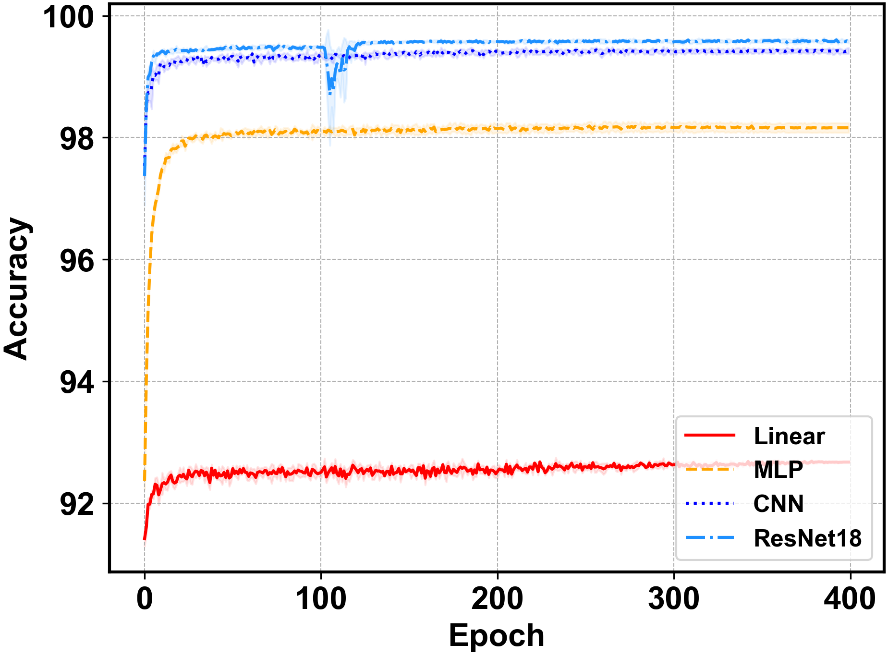

# RPipe
Research Pipeline
 
## Requirements
See `requirements.txt`

## Instructions
- Use `make.sh` to generate run script
- Use `make.py` to generate exp script
- Use `process.py` to process exp results
- Hyperparameters can be found in `config.yml` and `process_control()` in `module/hyper.py`

## Examples
 - Generate run script
    ```ruby
    bash make.sh
    ```
 - Generate run script
    ```ruby
    python make.py --mode base
    ```
 - Train with MNIST and linear model
    ```ruby
    python train_model.py --control_name MNIST_linear
    ```
 - Test with CIFAR10 and resnet18 model
    ```ruby
    python test_model.py --control_name CIFAR10_resnet18
    ```
 - Process exp results
    ```ruby
    python process.py
    ```

## Results
- Learning curves of MNIST
<p align="center">

</p>


- Learning curves of CIFAR10
<p align="center">

</p>


## Acknowledgements
*Enmao Diao*

## Model 调研自动化（gyd）

此分支实现了模型调研自动化首版 skill 和 Python CLI：CSV 接收、证据档案、字段增量计划、人工修改保护及中断恢复。Python 3.11+ 标准库即可运行；当前云环境按用户要求直接同步Grokbot成品CSV：统一字段格式后批量写入、回读，并保护人工字段及评分规则；后台Codex与MD研究保留为可选能力，日常同步不依赖它们。详情见使用指南。

- [Skill 与使用指南](skills/model-research/README.md)
- [Agent 操作入口](skills/model-research/SKILL.md)

- [文档导航](docs/README.md)
- [仓库协作约定](REPO.md)
- [架构设计](<docs/架构设计 Architecture Design 模型调研自动化.md>)
- [开发计划](<docs/开发计划 Development Plan 模型调研自动化.md>)

项目已安装的外部技能由 `skills-lock.json` 记录，本地目录 `.agents/skills/` 不随源码提交。恢复安装与模板采用范围见文档导航中的技能与环境记录；技能安装不代表飞书授权或定时任务部署完成。
