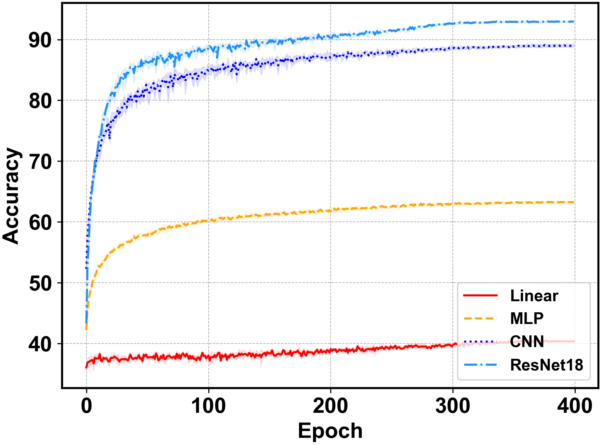

# RPipe
Research Pipeline
 
## Requirements
See `requirements.txt`

## Instructions
- Use `make.sh` to generate run script
- Use `make.py` to generate exp script
- Use `process.py` to process exp results
- Hyperparameters can be found in `config.yml` and `process_control()` in `module/hyper.py`

## Examples
 - Generate run script
    ```ruby
    bash make.sh
    ```
 - Generate run script
    ```ruby
    python make.py --mode base
    ```
 - Train with MNIST and linear model
    ```ruby
    python train_model.py --control_name MNIST_linear
    ```
 - Test with CIFAR10 and resnet18 model
    ```ruby
    python test_model.py --control_name CIFAR10_resnet18
    ```
 - Process exp results
    ```ruby
    python process.py
    ```

## Results
- Learning curves of MNIST
<p align="center">

</p>


- Learning curves of CIFAR10
<p align="center">

</p>


## Acknowledgements
*Enmao Diao*

## Model 资料与评测维护（gyd）

此分支在原训练流程之外提供 Codex 日报生产、CSV 增量同步、只读字段与一致性校验，以及语言模型代码、Agent、数学评分维护。日报生产交付 CSV 和调研 Markdown，评分维护保留专项与基座单列。

- [Codex 日报完整工作流程](docs/Codex模型日报完整工作流程.md)
- [使用指南](skills/model-research/README.md)与[Skill](skills/model-research/SKILL.md)
- [文档导航](docs/README.md)与[项目约定](REPO.md)
- [服务器部署与验收](skills/model-research/references/server-deployment.md)

真实配置、状态、资料和凭据均放仓外。历史方案及报告快照已从当前树清理，可通过 Git 和私有归档查阅。
