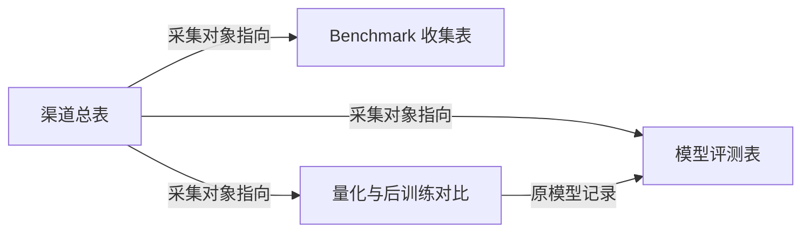

# Schema

这份文档规定 [模型评测 Base](https://dreamsoul.feishu.cn/base/L47LbtaVWabz1qs7pz8c6jYunbb) 里四张表的字段交付。自动化调度、额度、部署不在本文范围。

## 填写须知

格子里只放一项可核对的事实。阅读过程、引用原文、取舍理由写在 Agent 自己的工作记录里，不写进格子。

- 空着表示未知。不要写「未知」「暂无」「N/A」「-」「无」。数字列的空不是 0 分。
- 选项列只填本文写出的那一个字符串。大小写、空格、斜杠不同都算另一个词。对不上就空着，不新建选项。
- 文本列有长度上限。超长就删到只剩事实，不把调研笔记塞进去。
- 链接列只放一个 URL，不以中文说明、论文题名或第二个链接结尾。
- 数字列只放一个数，单位在字段名里。不写「约」「左右」或附带条件。
- 公式列由表格自己计算。Agent 不写入、不改公式。
- 同一模型的不同变体、revision、思考预算各占一行。不把别的变体或底层模型的成绩抄到本行。

## 表与视图



模型表上的成绩列按列名对应 Benchmark 收集表里的一条记录。量化表用「原模型记录」链接模型评测表的一行。下面写的是每个视图应当如何筛选、排序和显示。显示字段只使用本文后面规定的字段。输出含文本，指「输出」包含 `文本`。

### 模型评测表

登记一个可区分的模型配置，并按视图查看代码、Agent、数学能力。一行由名称、发布方、版本一起确定。

可比语言模型指：输出含文本，并且用途类别是 `通用与推理`、`代码` 或 `多模态文本能力`。

#### Grid

显示全部行，不筛选。按发布方升序。

显示：模型名称、发布方、版本、获取地址、输入、输出、任务类型、模型规模、架构、开放、许可、简介、限制与缺失、运行框架、证据状态、用途类别、筛选状态、核对日期、评分版本。

#### 语言模型能力筛选

只显示可比语言模型。

显示：模型名称、发布方、输入、输出、架构、运行框架、用途类别、筛选状态、证据状态、评分版本、核对日期、获取地址、逐项评测依据、代码有效子项数、代码覆盖率 %、代码能力分｜初筛、Agent有效子项数、Agent覆盖率 %、Agent能力分｜初筛、数学有效子项数、数学覆盖率 %、数学能力分｜初筛、LCB v6｜代码、LCB v5｜代码、LCB v4｜代码、LCB 其他口径｜代码、HumanEval+｜代码、HumanEval｜代码基础、MBPP+｜代码、MBPP｜代码基础、SWE Verified｜代码工程、SWE Pro｜代码工程、BFCL v4｜工具调用、BFCL v3｜工具调用、Terminal 2.1｜Agent、Terminal 2.0｜Agent、τ² 综合｜Agent、τ³ 综合｜Agent、AIME 2026｜数学、AIME 2025｜数学、HMMT 2026 Feb｜数学、HMMT 2025 Feb｜数学、HMMT 2025 Nov｜数学、MATH-500｜数学、MATH｜数学基础、标化｜LCB v6｜代码、标化｜SWE Verified｜代码工程、标化｜HumanEval+｜代码、标化｜BFCL v4｜工具调用、标化｜Terminal 2.1｜Agent、标化｜τ² 综合｜Agent、标化｜AIME 2025｜数学、标化｜AIME 2026｜数学、标化｜HMMT 2025 Feb｜数学、标化｜HMMT 2026 Feb｜数学、标化｜MATH-500｜数学。

#### 代码优先

只显示可比语言模型，并且代码能力分有值。按代码能力分从高到低。

显示：模型名称、输入、输出、架构、运行框架、用途类别、获取地址、逐项评测依据、代码有效子项数、代码覆盖率 %、代码能力分｜初筛、LCB v6｜代码、LCB v5｜代码、LCB v4｜代码、LCB 其他口径｜代码、HumanEval+｜代码、HumanEval｜代码基础、MBPP+｜代码、MBPP｜代码基础、SWE Verified｜代码工程、SWE Pro｜代码工程、标化｜LCB v6｜代码、标化｜SWE Verified｜代码工程、标化｜HumanEval+｜代码。

#### Agent优先

只显示可比语言模型，并且 Agent能力分有值。按 Agent能力分从高到低。

显示：模型名称、输入、输出、架构、运行框架、用途类别、获取地址、逐项评测依据、Agent有效子项数、Agent覆盖率 %、Agent能力分｜初筛、BFCL v4｜工具调用、BFCL v3｜工具调用、Terminal 2.1｜Agent、Terminal 2.0｜Agent、τ² 综合｜Agent、τ³ 综合｜Agent、标化｜BFCL v4｜工具调用、标化｜Terminal 2.1｜Agent、标化｜τ² 综合｜Agent。

#### 数学2025

只显示可比语言模型，并且 `AIME 2025｜数学`、`HMMT 2025 Feb｜数学`、`HMMT 2025 Nov｜数学` 至少有一列有值。按数学能力分从高到低。

显示：模型名称、输入、输出、架构、运行框架、用途类别、获取地址、逐项评测依据、数学有效子项数、数学覆盖率 %、数学能力分｜初筛、AIME 2025｜数学、HMMT 2025 Feb｜数学、HMMT 2025 Nov｜数学、MATH-500｜数学、MATH｜数学基础、标化｜AIME 2025｜数学、标化｜HMMT 2025 Feb｜数学、标化｜MATH-500｜数学。

#### 数学2026

只显示可比语言模型，并且 `AIME 2026｜数学` 或 `HMMT 2026 Feb｜数学` 有值。按数学能力分从高到低。

显示：模型名称、输入、输出、架构、运行框架、用途类别、获取地址、逐项评测依据、数学有效子项数、数学覆盖率 %、数学能力分｜初筛、AIME 2026｜数学、HMMT 2026 Feb｜数学、MATH-500｜数学、MATH｜数学基础、标化｜AIME 2026｜数学、标化｜HMMT 2026 Feb｜数学、标化｜MATH-500｜数学。

#### 待补证据

只显示输出含文本、筛选状态为 `证据不足`、用途类别属于可比语言模型的行。

显示：模型名称、输入、输出、架构、运行框架、证据状态、用途类别、筛选状态、限制与缺失、获取地址、逐项评测依据。

#### 专项与基座

只显示输出含文本、用途类别为 `翻译专项` 或 `基座研究` 的行。按用途类别分组。

显示：模型名称、输入、输出、架构、运行框架、用途类别、筛选状态、简介、限制与缺失、获取地址。

#### 基础信息

显示全部行，不筛选。

显示：模型名称、发布方、版本、获取地址、输入、输出、任务类型、模型规模、架构、开放、许可、简介、运行框架。

### Benchmark 收集表

登记一个 Benchmark 的一个版本，供模型评测表的成绩列引用。一行由名称加版本确定。

#### Grid

显示全部行，不筛选。

显示：名称、发布方、类型、模态与任务、简介、版本、数据与规模、评价指标、使用方式、开源与许可、官方地址、端侧相关性、限制与缺失、来源与日期。

### 量化与后训练对比

登记一个制品文件，或一组必须同时使用的分片，记录量化、格式转换和训练衍生产物。用「原模型记录」指向模型评测表。

「有同协议任务对照」「有分布偏移对照」「量化文件与大小」「训练衍生谱系」的显示字段与「制品与效果」相同，并按原模型记录分组。

#### 表格

显示全部行，不筛选。

显示：制品或产物、原模型记录、产物类型、基座或直接来源、教师或训练关系、发布者、发布身份、格式与精度、权重文件大小 GB、大小口径、峰值显存 GB、生成速度 tok_s、上下文 tokens、硬件与后端条件、KV缓存配置、任务效果、相对参考变化、比较基准、KL散度、困惑度 PPL、参考困惑度 PPL、同首选token率 %、效果证据、关键限制、制品入口、评测来源、核对日期。

#### 制品与效果

显示全部行，不筛选。按原模型记录分组。

显示：制品或产物、原模型记录、产物类型、发布者、发布身份、格式与精度、权重文件大小 GB、大小口径、效果证据、任务效果、相对参考变化、比较基准、KL散度、困惑度 PPL、参考困惑度 PPL、同首选token率 %、教师或训练关系、基座或直接来源、关键限制、硬件与后端条件、制品入口、评测来源、核对日期。

#### 有同协议任务对照

只显示效果证据为 `有同协议任务对照` 的行。

#### 有分布偏移对照

只显示效果证据为 `有分布偏移对照` 的行。

#### 量化文件与大小

只显示权重文件大小 GB 有值的行。

#### 训练衍生谱系

只显示产物类型为 `训练衍生产物` 或 `量化感知训练` 的行。

### 渠道总表

登记一个采集入口。渠道 ID 一旦发出就不再改写。

#### 表格

显示全部行，不筛选。

显示：渠道ID、渠道名称、发布主体、平台、入口链接、渠道性质、采集对象、首次发现、来源依据、状态、已知访问问题。

## 模型评测表

一行是一个可区分的模型配置：名称、发布方、版本三者一起确定这一行。

### 身份与事实

| 字段 | 类型 | 交付 |
| --- | --- | --- |
| 模型名称 | 文本，≤80 字 | 模型卡上的正式名，含 Base、Instruct 等变体。不加口号、参数量、许可证 |
| 发布方 | 单选 | 一家机构一个选项，用官方英文显示名。不加中文括注，不加「身份未确认」 |
| 版本 | 文本，≤40 字 | 一个 revision、发行标签或版本号。没有就空着。不写「最新」 |
| 获取地址 | 文本，一个 URL | 官方仓库或模型卡首页。论文、镜像、说明不放在这格 |
| 输入 | 多选 | 只允许 `文本` `图像` `音频` `视频`。不新增组合项 |
| 输出 | 多选 | 只允许 `文本` `图像` `音频` `视频` `向量` `分数` |
| 任务类型 | 多选 | 只允许 `对话` `代码` `数学` `图像生成` `视频生成` `语音识别` `语音合成` `向量` `重排序` `OCR`。有几项勾几项，不新增 `对话+代码` 这类组合项。对不上就空着 |
| 模型规模 | 文本，≤16 字 | 只写 `7B` `70B` `8x7B` 这种参数量。没有明确参数量就空着。不写权重体积、精度、制品 |
| 架构 | 文本，≤24 字 | 一个结构短名，例如 `Decoder-only` `MoE` `Encoder-decoder`。只写模型卡上的结构族。不写组件清单、基座名、参数量 |
| 开放 | 单选 | 只允许 `权重可下载` `需申请` `仅接口` `未公开`。不写许可证名，不写仓库里有没有 LICENSE 文件 |
| 许可 | 单选 | 只允许 `Apache-2.0` `MIT` `BSD-2-Clause` `BSD-3-Clause` `GPL-3.0` `CC-BY-4.0` `CC-BY-NC-4.0` `CC-BY-NC-SA-4.0` `Llama-3.1` `Llama-3.2` `Gemma` `专有` `未声明`。对不上就空着，不粘贴条款 |
| 简介 | 文本，≤24 字 | 只补「任务类型」那 10 个词说不清的一个用途，句式只有 `用于{动作}`。动作是一个动宾短语，例如 `用于按文字描述设计音色`、`用于把文档版面转成 Markdown`。任务类型已经说清就空着。不写模型名、发布方、参数量、成绩、日期、许可。量化、蒸馏、继续训练、适配器写在量化表的「基座或直接来源」和「教师或训练关系」，不写在这里 |
| 限制与缺失 | 文本，≤120 字 | 最多 3 条缺失事实，用中文分号分开。没有就空着 |
| 运行框架 | 多选 | 只使用现有 14 项：`Transformers` `llama.cpp` `vLLM` `MLX` `TensorRT-LLM` `SGLang` `Diffusers` `DiffSynth-Studio` `ONNX Runtime` `LiteRT` `PyTorch` `PaddlePaddle` `ESPnet` `qwen-tts`。文档没写就空着 |
| 证据状态 | 单选 | `已核对公开成绩` `已查原始来源未找到目标成绩` `来源受限或待补核` |
| 用途类别 | 单选 | 只允许 `通用与推理` `代码` `基座研究` `多模态文本能力` `翻译专项`。`基座研究` 和 `翻译专项` 归入「专项与基座」。其余三项进入语言模型能力比较。对不上就空着 |
| 筛选状态 | 单选 | 只允许 `可按单项筛选` `证据不足` `专项用途单列` `基座单列`。用途类别为 `基座研究` 时填 `基座单列`，为 `翻译专项` 时填 `专项用途单列`。其余有足够成绩填 `可按单项筛选`，成绩不够填 `证据不足` |
| 核对日期 | 日期 | 最近一次核对成绩的日历日，不写时间说明 |
| 评分版本 | 文本，≤24 字 | 当前只填 `v0.4`。没有重算标化就空着 |

### 逐项评测依据

文本，≤500 字。不拆成多列：一行有多组成绩，拆开后每一列仍要把多组来源拼在一起。分数写在成绩列，指标由列名规定。本格只在填了原始分时写，每个成绩一行，三段用中文分号分开：列名、工具、来源 URL。

```text
LCB v6｜代码；无工具；https://huggingface.co/org/model
AIME 2025｜数学；无工具；https://example.com/report
```

列名没有钉死口径时，在工具后加一个词，例如 `IFEval｜指令遵循；无工具；严格；https://example.com/ifeval`。某一列说不清工具或来源，那个分数不填，这一行也不写。

### 成绩列

成绩留在模型评测表上，用加列，不另建成绩表。列名与下表相同，写成 `短名｜能力词`。能力词用表里已有的写法：`代码` `代码基础` `代码工程` `工具调用` `Agent` `数学` `数学基础` `科学` `通用` `指令遵循`。`工具调用` 保持为 `工具调用`，不改写成 `Agent`。

一列是 Benchmark 收集表里的一个版本、一个指标，百分制原始分，范围 0–100。不同版本、不同年份、不同指标各占一列。增加成绩列时，先在下面这张表加一行，写清列名和只接受的口径，再在模型表加列。Benchmark 收集表已有这一行，版本只有一个，指标只有一个，模型表上还没有同一版本、同一指标的列。AI 只写入来源里写明的那个分数。来源没有这个数就空着。不把另一个版本或另一个指标写入已有列。

三项能力分只归入这些能力词：`代码` `代码基础` `代码工程` 归代码；`工具调用` `Agent` 归 Agent；`数学` `数学基础` 归数学。`科学` `通用` `指令遵循` 不进三项能力分。

标化列由冻结参考分布计算，列名比原始列多前缀 `标化｜`。只有已经纳入冻结参考的原始列才有标化列。新原始列先不加标化。Agent 只在重算时写入标化，不手估。

能力分、覆盖率、有效子项数是公式列，不手填。新原始列不自动进入能力分。当前权重是：代码为 LCB v6 50%、SWE Verified 40%、HumanEval+ 10%；Agent 为 BFCL v4 30%、Terminal 2.1 40%、τ² 综合 30%；数学为 AIME 50%、HMMT Feb 30%、MATH-500 20%，2025 与 2026 分开。覆盖不足 70% 或有效子项少于 2 时，公式不显示能力分。权重、进入能力分的列或覆盖门槛有变化时，先改这一段和下面的标化列清单，再改模型表上的公式。规范里的数字和公式保持一致。

#### 成绩列口径

模型表上的成绩列以这张表为准。新列先加进行。

| 列名 | 只接受 |
| --- | --- |
| LCB v6｜代码 | LiveCodeBench v6，pass@1 |
| LCB v5｜代码 | v5，不填进 v6 |
| LCB v4｜代码 | v4，不填进 v6 |
| LCB 其他口径｜代码 | 版本已读到、但不是 v4/v5/v6 的 pass@1 |
| HumanEval+｜代码 | EvalPlus HumanEval+，pass@1。pass@5 不填 |
| HumanEval｜代码基础 | 原始 HumanEval pass@1，不填进 HumanEval+ |
| MBPP+｜代码 | MBPP+ pass@1 |
| MBPP｜代码基础 | 原始 MBPP pass@1，不填进 MBPP+ |
| SWE Verified｜代码工程 | SWE-bench Verified 的 resolved 百分比 |
| SWE Pro｜代码工程 | SWE-bench Pro，不填进 Verified |
| BFCL v4｜工具调用 | BFCL v4 overall |
| BFCL v3｜工具调用 | BFCL v3 overall，不填进 v4 |
| Terminal 2.1｜Agent | Terminal-Bench 2.1 |
| Terminal 2.0｜Agent | Terminal-Bench 2.0，不填进 2.1 |
| τ² 综合｜Agent | τ²-bench 多域综合 |
| τ³ 综合｜Agent | τ³-bench 多域综合，不填进 τ² |
| AIME 2026｜数学 | AIME 2026，无外部工具 |
| AIME 2025｜数学 | AIME 2025，无外部工具 |
| HMMT 2026 Feb｜数学 | 2026 年 2 月 |
| HMMT 2025 Feb｜数学 | 2025 年 2 月。届次不明不填 |
| HMMT 2025 Nov｜数学 | 2025 年 11 月，不填进 2 月列 |
| MATH-500｜数学 | MATH-500 子集的 accuracy |
| MATH｜数学基础 | 完整 MATH。不填进 MATH-500 |
| GPQA Diamond｜科学 | Diamond 子集。不参与三项能力分 |
| MMLU-Pro｜通用 | 不参与三项能力分 |
| IFEval｜指令遵循 | 不参与三项能力分。严格或宽松口径写在逐项评测依据 |

#### 已有标化列

只给已经纳入冻结参考的这些原始列计算标化：

`标化｜LCB v6｜代码`、`标化｜SWE Verified｜代码工程`、`标化｜HumanEval+｜代码`、`标化｜BFCL v4｜工具调用`、`标化｜Terminal 2.1｜Agent`、`标化｜τ² 综合｜Agent`、`标化｜AIME 2025｜数学`、`标化｜AIME 2026｜数学`、`标化｜HMMT 2025 Feb｜数学`、`标化｜HMMT 2026 Feb｜数学`、`标化｜MATH-500｜数学`。

数值是 0–100 的经验中位秩百分位，保留两位小数。它不是实时榜单名次。

#### 公式列

`代码有效子项数`、`代码覆盖率 %`、`代码能力分｜初筛`、`Agent有效子项数`、`Agent覆盖率 %`、`Agent能力分｜初筛`、`数学有效子项数`、`数学覆盖率 %`、`数学能力分｜初筛`。

## Benchmark 收集表

一行是一个 Benchmark 的一个版本。名称加版本确定这一行。

| 字段 | 类型 | 交付 |
| --- | --- | --- |
| 名称 | 文本，≤80 字 | 正式名称，不含版本号 |
| 发布方 | 文本，≤40 字 | 与模型表同一套机构短名 |
| 类型 | 多选 | 只允许 `测试集` `评测框架` `评测套件` `排行榜`。一项勾一项，不把多项拼成一个选项 |
| 模态与任务 | 文本，≤40 字 | 一个任务词，与模型表「任务类型」同一套词表 |
| 简介 | 文本，≤80 字 | 一句中文，只说它评什么 |
| 版本 | 文本，≤40 字 | 一个版本号、年份届次或 commit。没有就空着 |
| 数据与规模 | 文本，≤40 字 | 只写样本量或子集名，例如 `500 题`。不写数据从哪收集的过程 |
| 评价指标 | 文本，≤40 字 | 一个指标短名，例如 `pass@1` `resolved%` `accuracy` |
| 使用方式 | 文本，≤80 字 | 一个入口 URL，或 `论文` `代码` `数据` 三词之一加一个 URL |
| 开源与许可 | 文本，≤40 字 | 许可证短名与模型表「许可」同一套。只有一个许可证时只写短名，例如 `Apache-2.0`。代码和数据不是同一个许可证时写成 `代码 {短名}；数据 {短名}`，例如 `代码 Apache-2.0；数据 专有` |
| 官方地址 | 文本，一个 URL | 官方首页或仓库 |
| 端侧相关性 | 文本，≤8 字 | 只写 `可离线` `依赖云端` `不明` |
| 限制与缺失 | 文本，≤120 字 | 最多 3 条，中文分号分开 |
| 来源与日期 | 文本，≤120 字 | `YYYY-MM-DD` 加一个 URL。不写结论 |

## 量化与后训练对比

一行是一个制品文件，或一组必须同时使用的分片。用「原模型记录」链接模型评测表里这一制品所属的那一行。

| 字段 | 类型 | 交付 |
| --- | --- | --- |
| 制品或产物 | 文本，≤80 字 | 文件名或官方制品名 |
| 原模型记录 | 链接 | 模型评测表中的一行，只链这一制品所量化或后训练的那个模型配置 |
| 产物类型 | 单选 | `原始参考权重` `权重量化` `量化感知训练` `格式转换` `训练衍生产物` |
| 基座或直接来源 | 文本，≤80 字 | 一个模型名或一个 URL |
| 教师或训练关系 | 文本，≤80 字 | 只写关系短句，例如 `蒸馏自 Qwen2.5-72B`。方法不明就空着 |
| 发布者 | 文本，≤40 字 | 与模型表同一套机构短名 |
| 发布身份 | 单选 | `原团队发布` `社区制品` |
| 格式与精度 | 文本，≤32 字 | 两段，中间一个空格：`{方法} {精度}`。方法只允许 `GGUF` `AWQ` `GPTQ` `EXL2` `MLX` `bitsandbytes` `NVFP` `浮点`。精度照官方块名，只留精度本身：GGUF 写 `Q4_K_M` `Q8_0` `IQ4_XS` 这种块名，EXL2 写 `4.0bpw` 这种，AWQ、GPTQ、MLX 写 `4bit` `8bit`，bitsandbytes 写 `NF4` `INT8`，NVFP 写 `NVFP4`，浮点写 `FP32` `FP16` `BF16` `FP8`。方法不在名单里，或官方没写精度，整格空着。不写文件名 |
| 权重文件大小 GB | 数字 | 文件字节合计除以 1e9，保留两位小数。不拿它填显存 |
| 大小口径 | 文本，≤40 字 | 只写 `含视觉投影` 或 `仅文本权重` |
| 峰值显存 GB | 数字 | 报告里的峰值显存。没有配置就空着，不用文件大小代替 |
| 生成速度 tok_s | 数字 | 一个速度数。硬件不在本格 |
| 上下文 tokens | 数字 | 一个整数 |
| 硬件与后端条件 | 文本，≤80 字 | `GPU 型号；后端`。例如 `H100；vLLM`。不写整段测试环境 |
| KV缓存配置 | 文本，≤40 字 | 一个配置短名，没有就空着 |
| 任务效果 | 文本，≤40 字 | 一个已有成绩列的名字加一个数，例如 `MMLU-Pro=72.1`。不写比较句 |
| 相对参考变化 | 文本，≤24 字 | 同协议成对差值，例如 `-1.2`。没有成对对照就空着 |
| 比较基准 | 文本，≤40 字 | 被比较的那个制品名 |
| KL散度 | 数字 | 一个数。语料名称不写在本格，写进关键限制 |
| 困惑度 PPL | 数字 | 一个数 |
| 参考困惑度 PPL | 数字 | 一个数 |
| 同首选token率 % | 数字 | 0–100 |
| 效果证据 | 单选 | `有同协议任务对照` `有分布偏移对照` `仅有制品与大小` `后训练关系已核对` `效果未找到` `仅来源关系已核对` |
| 关键限制 | 文本，≤80 字 | 一条限制 |
| 制品入口 | 文本，一个 URL | 该制品的下载页或仓库路径 |
| 评测来源 | 文本，一个 URL | 测出速度、显存或效果的那一页 |
| 核对日期 | 日期 | 日历日 |

## 渠道总表

一行是一个采集入口。渠道 ID 一旦发出就不再改写，不复用到另一个网站。

| 字段 | 类型 | 交付 |
| --- | --- | --- |
| 渠道ID | 文本，≤16 字 | 已有编号续写。不改旧号 |
| 渠道名称 | 文本，≤40 字 | 站点或栏目的正式名 |
| 发布主体 | 文本，≤40 字 | 与模型表同一套机构短名。个人站点写账号名 |
| 平台 | 单选 | `Hugging Face` `arXiv` `GitHub` `ModelScope` `Artificial Analysis` `MLCommons` `Mozilla` `独立站点` `OpenSLR` `博客` `媒体` |
| 入口链接 | 文本，一个 URL | 栏目首页，不带跟踪参数 |
| 渠道性质 | 单选 | `聚合` `论文` `独立评测` `官方发布` `社区` |
| 采集对象 | 多选 | `模型` `Benchmark` `量化及训练衍生产物` |
| 首次发现 | 日期 | 第一次列入本表的日历日 |
| 来源依据 | 文本，一个 URL | 说明为什么把它当作采集入口的那一页 |
| 状态 | 单选 | `启用` `未覆盖` `访问异常` `待覆盖` |
| 备注 | 文本 | 新记录留空 |
| 已知访问问题 | 文本，≤80 字 | 一条访问事实，例如 `需登录`。没有就空着 |
