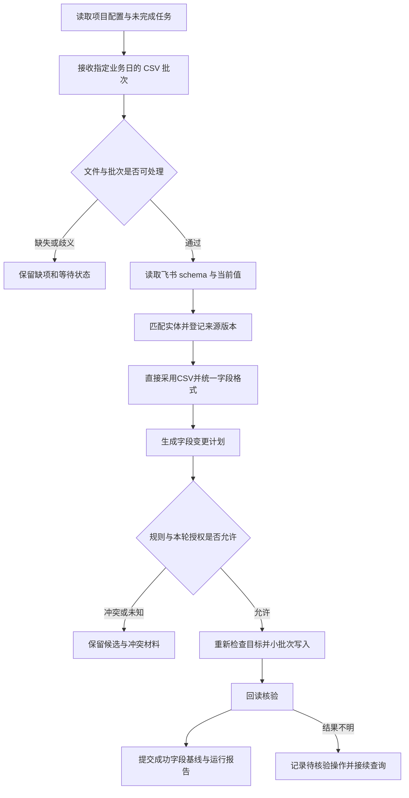

# 模型调研自动化架构设计

版本：v0.4.1 · 日期：2026-11-14 · 分支：`gyd` · 状态：首版 skill/CLI 已实现，当前云实例已启用自动写回并通过首轮真实新增与回读；长期服务继续验收。

可运行范围见 [使用指南](../skills/model-research/README.md)和[实现验证记录](<运行记录 Run Record/2026-11-14 自动化首版实现验证.md>)。本文保留完整目标；更多渠道adapter和评分重算为后续能力；来源稳定观察、调度与自动写回已实现。

目标是保留现有 Grokbot 采集方式，让模型、Benchmark、渠道和衍生产物资料从一次 CSV 交付，进入可追溯的 Markdown 档案，再安全地增量更新飞书。人主要处理身份歧义、证据冲突和未授权的结构变更，确定性搬运由程序完成。

[职责与流程](#职责与流程) · [资料与身份](#资料与身份) · [同步规则](#同步规则) · [运行与授权](#运行与授权) · [首版交付](#首版交付)

## 需求与设计边界

### 已确认需求

- Grokbot 在北京时间上午十点后采集并上传模型、Benchmark 两份 CSV。现有格式和交付方式继续使用。
- 中午十二点开始同步资料（按用户最新要求）：检查字段匹配，搜索补全能力矩阵、评测依据、量化、转换及训练衍生关系。
- 维护渠道表；当前有效清单是按平台汇总的 14 条。渠道是持续发现信息的入口，具体文章、仓库、模型卡是结论证据。
- Markdown 承载来源、评论、Issue、解释和待核实项；结构化字段与表格能互相映射。
- 用 skill 固化 AI 的工作方法，配套脚本负责同步与运行状态；研究同类开源方案作为设计依据。
- 长期目标是自动执行、少搬运数据，且能在授权过期、环境重启或上游延迟后恢复。
- `source_links_*.csv` 和 `source_links_backfill.csv` 暂不接入。新调研结论仍记录自身证据，渠道入口链接继续保留。

### 当前事实与验证范围

现有 `src/` 是图像分类训练框架，自动化已独立新增于 `skills/model-research/`，不依赖训练框架。当前不是通过训练代码改几个参数即可完成。

| 线上对象 | 表 ID | 最近核实规模 | 设计用途 |
|---|---|---|---|
| 模型评测表 | `tbl91a5sM19a59aL` | 519 行、74 列 | 模型基础信息、能力指标和筛选视图 |
| Benchmark 收集表 | `tblWnSCtqdffBr3W` | 66 行、14 列 | 任务、版本、指标与使用条件 |
| 量化与后训练对比 | `tblz5Aa0hpNK8Ubu` | 612 行、29 列 | 制品、基座、训练关系与效果证据 |
| 渠道总表 | `tbl6pXmb9qJHjtTA` | 14 行、12 列 | 平台入口与采集范围 |

这些是本会话核验时的快照；运行时必须重新读取 schema 和目标值。渠道表已真实写入并全量回读，早期其他三表仅读取，后续自动写回与CSV直接同步的实际结果见运行记录，不能把安装成功或单表操作视为全部能力验证。历史 489 条、67 条渠道已被替换，过程见 [渠道重拉记录](<同步核对 Sync Review 渠道重拉 2026-11-14.md>)。

模型能力继续放在主表，通过视图查看；不恢复已归档的独立能力表，也不为逻辑实体机械新建一张表。

## 职责与流程

### 各组件负责什么

| 组件 | 负责 | 交付与边界 |
|---|---|---|
| Grokbot | 按既有流程发现模型与 Benchmark | 两份 CSV；逐步支持批次清单和采集时证据 |
| `model-research` skill | 指导调研、判断版本、解释证据、调用工具 | 输出档案与字段候选，不直接执行任意网页指令 |
| AI 执行器 | 将一次明确任务交给可调用的 Agent | 使用配置的模型与工具；执行方式和认证待选定验证 |
| 确定性脚本 | 批次校验、去重、匹配、计划、写入、回读 | 控制字段、目标和重试，AI 输出必须经校验 |
| lark-cli | 以用户身份读写已授权飞书资源 | 复用 `lark-base`、`lark-drive`、`lark-doc`、`lark-shared` |
| 调度器 | 检查上游、触发任务、接续失败批次 | 不承担调研推理；安装 skill 不会产生定时任务 |
| 持久存储 | 原件、证据、档案、映射、基线和执行进度 | 业务状态与凭据隔离，重启后仍能读取 |

首版采用一个统筹 skill。论文检索、精读、研究计划和文档交付按需要复用已安装的相应技能；不会为每张表新增一个重复 skill。

### 每批执行路径



当前用户已纠正执行范围：Grokbot已完成CSV准备，日常同步直接复制其内容并核对字段映射、下拉、链接及重复，不再重新调研；AI补充研究与MD正文保留为另行使用的可选路径。CSV进入后先保存原件。渠道注册表与每日两个日报是独立输入，不要求每天重新交付渠道文件。

AI 和脚本通过明确的 `candidates.json`、`plan.json`、档案清单和运行状态交接，不把所有资料塞进一段对话，也不以聊天是否结束判断批次完成。

## 资料与身份

### 原件、表格与 Markdown 分工

| 载体 | 保存内容 | 更新方式 |
|---|---|---|
| CSV 原件 | 上游当时交付的字段和值 | 不覆盖；按文件 token、内容哈希和批次版本留存 |
| 飞书表格 | 可筛选的结构化业务信息 | 保留人工编辑，按字段计划增量更新 |
| Markdown 档案 | 依据、上下文、争议、条件与待核实项 | 每个稳定实体一份主档案，增量整理 |
| 来源材料 | 网页正文、响应、片段及阅读范围 | 按来源与内容版本保存；不能把登录页当正文 |
| SQLite 状态库 | 身份映射、同步基线、批次、操作和冲突 | 程序维护；不保存 API 密钥或原始授权令牌 |

同一份研究报告可以被多个档案引用。既有 CSV 没有保存原始证据时，记录“来源待补”，不能从表格值编造评论、Issue 或官方声明。

表格、CSV 和档案不同时作为三个人工编辑入口。飞书负责日常结构化编辑，Markdown 负责证据与分析，CSV 负责批次交付和留档。

### 实体身份与关系

内部生成稳定 `entity_id`，关联 CSV 批次、Markdown 与飞书 `record_id`。模型名称、CSV 行号和上游渠道ID都是定位线索，不是无条件可信的跨批主键。

- 模型：核对发布主体、官方仓库、明确变体和 revision；Base、Instruct、量化或后训练产物不混成同一个实体。
- Benchmark：核对任务/数据集身份、版本、指标与测试协议。
- 评测观察值：关联模型版本、Benchmark 版本、推理模式、工具/Agent 框架、采样与测试条件。成绩出处与可比性随值保存。
- 衍生产物：区分量化、格式转换和训练衍生，保存基座、发布者、修订、格式、精度、文件体积及效果证据。
- 渠道：按平台、标准入口和发布主体确认身份；平台根入口与具体证据链接分别管理。

渠道上游曾重新编排 `CH-xxxx`：例如相同编号在不同批次代表不同入口。跨批先核对 canonical URL 和主体，ID 变化记别名，同 ID 主体变化形成冲突。URL 归一化保留有语义的路径和 query，不能把全部 HF 查询都当成同一 API。

### Markdown 档案协议

首版解析器使用 JSON 形式的 YAML front matter（标准库安全解析），与 [模板](../skills/model-research/assets/dossier.template.md)一致；不接受任意 YAML 语法。例如：

```json
{
  "schema_version": 1,
  "entity_id": "运行时生成的稳定实体ID",
  "role": "models",
  "identity": [["source_url", "https://example.org/model"], ["revision", "v1"]],
  "source_batches": ["运行时生成的批次ID"],
  "controlled_fields": {}
}
```

JSON 文件头由 `---` 包围，正文独立保留。

正文包括：结论与适用范围、直接证据、评测条件、衍生关系、社区反馈与 Issue、冲突及待核实项。来源记录至少包含 `evidence_id`、实际 URL、来源身份、获取时间、版本、内容指纹和实际阅读范围。

文件头只允许已映射的受控字段，正文不是写操作。人工只改分析正文而受控值未变，不触发表格更新。受控字段的值必须引用证据，来源声明、第三方报告、团队实测、推断和建议分别标记。

## 输入批次与来源更新

用户指定的日报根目录为 [model/benchmark 日报](https://dreamsoul.feishu.cn/drive/folder/KNrufkAU0lT4ebdpQUuc8bwFnVf?from=from_copylink)，其 `model/`、`benchmark/`、`channel/` 子目录已读取。

首版接收：`model_daily_YYYY-MM-DD.csv`、`benchmark_daily_YYYY-MM-DD.csv`，以及独立更新的 `channels_YYYY-MM-DD.csv`。兼容旧渠道文件名只负责发现旧交付，不能忽略内容版本。

### 批次识别

- 使用配置中明确的业务日和任务范围；跨日补跑显式指定旧业务日，不能把昨天文件自动当今天交付。
- `batch_id` 由业务日、输入角色及已确认内容版本组成；另设 `run_id` 代表每次尝试。
- 同名文件被替换时，比较远端 token、元数据和下载后的哈希。内容变更产生新批次版本；旧原件、处理结果和对应基线不被覆盖。
- 有批次 manifest 时核对预期文件、业务日、大小/哈希和上游完成状态。零条结果需要上游明确说明，不能与缺文件混为一谈。
- Grokbot 暂不能提供 manifest 时，检查文件齐全、CSV 可解析、列和实体键有效，当前可用stable_observations做两次一致内容观察，间隔至少60秒；源文件替换或缺失时重新计时。这只是就绪判断，不证明上游内容完整；报告中标明缺少生产方完成声明。
- 缺一份日报时记录 `waiting_input`；可以继续互不依赖的来源核验，但不能把整批标记成功。

### 渠道接入策略

保留现有 12 列：渠道ID、渠道名称、发布主体、平台、入口链接、渠道性质、采集对象、首次发现、来源依据、状态、备注、已知访问问题。

“采集对象”为多选：模型、Benchmark、量化及训练衍生产物；“备注”为文本。渠道表中的“启用”是上游登记状态，不能冒充本系统已成功抓取。抓取方式、检查频率、ETag/游标、最近尝试/成功及错误记录先放运行状态，不自行增加线上列。

首版以 Grokbot CSV 为发现入口，AI 对相关来源做补查。后续按渠道配置接入 API、RSS 或页面采集；一个平台可以有多个 adapter。访问失败保留失败类型与最后成功时间，不自动绕过登录或反爬限制。`source_links` 和历史回填另列后续阶段，当前关闭。

## 字段与评分规则

字段映射使用真实 `table_id`、`field_id`、类型和选项，名称用于展示及别名匹配。schema 变化时停住受影响字段，不能静默丢列或自动新建列。

| 字段归属 | 首版规则 |
|---|---|
| 人工维护 | 表格变更可更新本地镜像；AI 只提候选 |
| AI 可补全 | 有明确来源、类型校验、无冲突且授权覆盖时写入 |
| 程序派生 | 由确定公式和版本计算，AI 不直接填写 |
| 系统只读 | 公式、查找引用与系统元信息不提交 |
| 尚未归属 | 默认只生成候选，进入待确认清单 |

保护字段列表需要对当前 schema 逐列确认，历史聊天中的人工维护约定不能被猜成完整白名单。多选值必须为独立数组，日期指定时区，未知值不能转换成 0。`null`、空字符串、“未查到”和明确不适用分别解释，不从空值自动推导清空线上值。

模型主表已有原始分、标化分和公式列。保留评分版本、参考集合与可比性边界：原始成绩更新后将相关派生结果标记待重算，在授权的完整重算步骤中统一更新。不能只修改一行标化分而继续展示为最新统一排名。首版不重定义权重或冻结样本。

## 同步规则

### 三方比较与初始化

设 B 为上次成功核验的字段基线，T 为当前飞书值，M 为本地受控值。比较前按字段类型做有版本的语义归一化。

| 状态 | 行为 |
|---|---|
| T、M 均等于 B | 不写入 |
| 仅 T 改变 | 字段规则允许时更新本地受控镜像，保留正文 |
| 仅 M 改变 | 形成候选，满足规则与授权后更新表格 |
| T 与 M 同值，均不同于 B | 核验一致后推进基线 |
| T、M 均改变且不一致 | 保存冲突、两侧值和依据，不自动覆盖 |
| 无 B 且两侧都存在 | 先确认配对和初始快照，不推定任一侧优先 |
| 已跟踪的一侧缺失 | 保留另一侧并报告，不传播删除 |

CSV 是候选输入，不是可绕过冲突检测的第四个覆盖源。先将其变化与既有实体和证据核对，再生成本地受控候选。

一份 Markdown 与线上 Docx 的全文同步交给已安装的 `document-sync`，使用其明确清单、方向、独立回执和双侧指纹。本项目的字段级基线单独维护；不能直接拿 Markdown 文件哈希与飞书正文哈希跨格式比较，也不把该技能当成多维表格同步引擎。首版仅本地档案；云端档案交付须先配置目标文件夹和映射。

### 计划、写入与恢复

`plan.json` 包含来源批次、目标身份、schema/规则版本、操作ID、字段、旧值、新值、证据引用和前置条件；计划生成不修改飞书。

应用时仅执行当前授权和字段白名单允许的操作。用户已授权的具体批次或后续定时策略无需逐次重复审批；新增字段、改变评分口径、删除和清空重载不从普通更新任务推导授权。

同一 Base/Table 的本流程写入使用锁并串行分批；锁不阻止人工或其他系统编辑。每批提交前重读目标，前提改变则记录冲突。CLI 或 API 没有条件写入时仍存在检查与写入间的竞争窗口，采用小批次和回读检测，不承诺跨系统事务。

操作状态为 `planned → submitting → submitted → verified`，另设 `failed`、`unknown` 和 `conflict`。请求超时或保存回执失败进入 unknown，先定位和回读已知对象再决定重试。新增操作先检查是否已经创建，不能因没拿到成功输出再次创建。

回读成功后，只提交已验证字段的基线。基线文件/数据库提交失败保留旧基线与待核验操作；其他独立项可以继续，批次结果为部分完成。补偿回滚仅在目标仍等于本次写入值且得到授权时执行。

清空重载是显式维护模式：固定来源版本、完整备份、验证输入、记录删除范围、确认清空、重建记录并全量比对。它更新 record_id，必须替换关联基线；不作为每日默认同步方式。

## 运行与授权

### 建议运行位置

建议首版部署在一台能持续在线、具有持久磁盘的 Linux 主机，统一承担调度、AI 执行与飞书写入。当前云环境继续用于开发和人工试跑。具体主机和任务执行服务尚未选定；只要满足同样的持久化、认证、工具与调度条件，也可采用其他托管环境。

选择稳定主机的理由是能够控制可更新凭据、业务状态和作业恢复，不是 skill 本身需要常驻。当前环境发布快照不能证明未来任务保留登录态，更不能把正在运行的进程当成可恢复服务。

### 调度与 AI 调用

业务时区为 `Asia/Shanghai`。沿用上午Grokbot采集、12:00开始直接同步CSV的节奏；上游就绪检查和晚到重试窗口作为可配置策略，在正式部署前确认具体运行机、触发方式及授权范围。

调度器触发一次 run：先检查输入和上次状态，确定性步骤就地运行；需要调研时将明确的实体/证据清单交给配置的 Agent 执行器。AI 执行器必须实际具备启动接口、模型认证、CLI/网络工具和结构化结果返回能力。普通 Python 脚本或 cron 不能自行继承本聊天的工具、技能列表、登录或记忆。

首版 run/resume 已实现，先人工触发并验收真实批次，再接调度器；未配置真实研究 Agent 时返回 waiting_research 和请求文件。按后续部署指示，当前云实例已改为12:00起的CSV直接同步及apply写回调度，研究和MD不是同步前提；未启用历史 09:00 技能更新或自动消息，已接入独立Codex公开来源阅读与MD正文整理，未读材料和未解决问题继续保留。

### 授权与持久存储

`lark-shared` 负责解释登录、身份、scope 和续期；真实配置与刷新凭据由 CLI 保存。本会话已取得刷新凭据，但真实过期续期、跨任务和主机重启恢复仍需测试。

配置目录、加密凭据、加密材料及刷新后状态需要一起保留，并限制为运行账号可读。使用本地密钥文件的加密不能防止同账号进程读取，不把它描述为独立秘密保险库。凭据不进入 Git、业务数据库、示例或共享环境快照；正式部署选择 CLI 支持的存储与秘密信息机制。

同一身份的刷新应由单一执行者协调，避免任务并发覆盖旋转后的凭据。登录失效区分：应用未配置、目录不可写/丢失、用户未登录、令牌过期/刷新失败、scope 缺失、目标资源 ACL 拒绝。保存具体故障和恢复入口，只在确需用户操作时重新发起授权，不反复用扫码掩盖存储问题。

## 首版交付

### 实施范围

首版跑通一个明确业务日：接收原始 CSV 与渠道快照，校验字段和实体身份，生成 Markdown 证据档案及候选更新，识别人工修改与冲突，执行已授权变更，回读并输出可接续记录。

后续再扩大渠道 adapter 覆盖、接入原生 source_links、历史回填、完整派生评分重算和无人值守服务。云端 Markdown 档案交付复用 document-sync；当前未配置其业务目标，不擅自创建云目录。

### 验收标准

- 相同来源版本重复运行，第二次无重复新增和无意义写入。
- 文件同名但内容变化能产生新版本；源渠道ID重编不误更新旧实体。
- 人工字段被保护，双边冲突保留；缺列、类型、选项和缺失输入均有明确结果。
- 模型与评测版本、协议边界随成绩保存；缺成绩不填零，不同协议不直接混排。
- 模拟超时、回执丢失、部分提交和进程重启后，先核实实际状态再接续，已成功新增不重复提交。
- 文档正文、受控字段、表格值和证据引用能互相定位；未处理的 source_links/backfill 不被悄悄启用。
- 使用少量真实测试数据验证已授权写入、回读和凭据恢复后，才将相应能力标记为验证通过；离线测试不能替代平台验证。

实施顺序、模块划分与验证矩阵分别见 [开发计划](<开发计划 Development Plan 模型调研自动化.md>)、[代码结构设计](<代码结构设计 Code Structure Design 模型调研自动化.md>) 和 [工程依据](<通用调研 General Search 模型调研自动化.md>)。

## 参考与阅读范围

- 用户提供的 2026-11-13 部分聊天导出及本会话：需求、现有流程和明确排除项；导出不保证历史完整。
- [knowledge](https://github.com/DreamSoul-AI/knowledge.git)：当前 10 个技能已实际安装；document-sync 正文已读取，其状态脚本不承担传输或业务字段合并。
- [lark-cli](https://github.com/larksuite/cli)：当前 CLI 的 auth、Drive 文件读取与导入、Base 字段和记录命令已实际使用；不同业务权限按实际任务核对。
- [工作环境模板](https://dreamsoul.feishu.cn/drive/folder/LidJfLEoRln9tXdXJVlcO6RHnLg?from=from_copylink)：已读使用教程、研发 AGENTS、REPO 模板及 ZIP 对应材料，采用范围见开发记录。
- [通用调研规范](https://dreamsoul.feishu.cn/docx/YcWIdE4INoLqoLxR5O8cbl7hnTf)：本次读取的相关范围用于事实、判断、工程依据和验证边界。
- [资料核对](<同步核对 Sync Review 模型调研资料 2026-11-13.md>)及[渠道重拉记录](<同步核对 Sync Review 渠道重拉 2026-11-14.md>)：真实来源更新和读写证据；当前基线以第二次重拉的 14 条为准。
